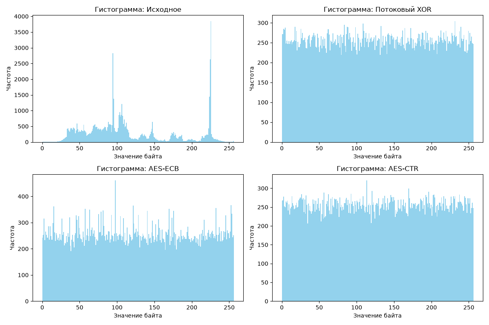
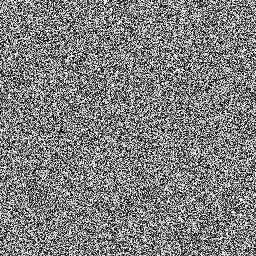
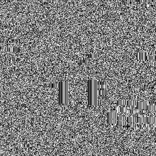
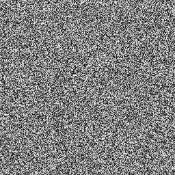

# Отчет

## 1. Постановка задачи

## Какие методы реализованы:

1)Потоковый XOR

2)Блочный шифр AES-ECB

3)Режим AES-CTR
    
## Какие изображения использовались: 
`gradient.png` , `checkerboard.png` и пользовательское изображение `akashi.png` (разрешение 256×256, оттенки серого).

## Что именно сравнивалось: 
энтропия распределения байтов, коэффициенты корреляции соседних пикселей (по горизонтали и вертикали), гистограммы распределения яркостей, а также чувствительность к изменению ключа (метрики NPCR и UACI).

## 2. Реализация

- Потоковый XOR: Ключ (`int`) инициализирует внутреннее состояние генератора `xorshift32`, который выдает гамму. Наложение происходит побайтово через операцию `XOR`:
  ```
  def xorshift32(seed, length):
      x = seed & 0xFFFFFFFF
      if x == 0: x = 1
      keystream = bytearray()
      for _ in range(length):
          x ^= (x << 13) & 0xFFFFFFFF
          x ^= (x >> 17) & 0xFFFFFFFF
          x ^= (x << 5) & 0xFFFFFFFF
          keystream.append(x & 0xFF)
      return bytes(keystream)

  def encrypt_xor(data_bytes, key_int):
      keystream = xorshift32(key_int, len(data_bytes))
      return bytes(b1 ^ b2 for b1, b2 in zip(data_bytes, keystream))
  ```

- Как выполняется AES: Для режима ECB используется PKCS7-паддинг, для режима CTR — динамический счетчик:

```
from Crypto.Cipher import AES
from Crypto.Util.Padding import pad, unpad

def encrypt_aes_ecb(data_bytes, key_bytes):
    cipher = AES.new(key_bytes, AES.MODE_ECB)
    return cipher.encrypt(pad(data_bytes, AES.block_size))

def encrypt_aes_ctr(data_bytes, key_bytes):
    cipher = AES.new(key_bytes, AES.MODE_CTR)
    ciphertext = cipher.encrypt(data_bytes)
    return ciphertext, cipher.nonce  
```

Как хранятся IV/nonce: Уникальный вектор nonce сохраняется в файл метаданных results/meta.json в формате hex:
```
meta = {
    "algorithm": "aes-ctr",
    "source": "gradient.png",
    "nonce": nonce.hex(),
    "npcr": npcr,
    "uaci": uaci
}
```
Как проверяется обратимость: Сравнение исходных и расшифрованных байтов через криптографический хэш SHA-256:
```
import hashlib

def compute_sha256(data_bytes):
    return hashlib.sha256(data_bytes).hexdigest()

# Проверка:
assert compute_sha256(decrypted_bytes) == compute_sha256(original_bytes)
```

## 3. Методика эксперимента 
- Основное изображение: 
akashi.png

- Рассчитываемые метрики: 
энтропия Шеннона (H), коэффициент корреляции Пирсона для соседних пикселей.

- Объем выборки для корреляции: 
случайная выборка из N = 5000 пар соседних пикселей для горизонтального и вертикального направлений.

- Эксперимент с ключом: 
изменение одного байта в ключе AES-CTR с последующим расчетом метрик лавинного эффекта NPCR (процент изменившихся пикселей) и UACI (средняя интенсивность изменения).

```
import numpy as np

Вычисление энтропии Шеннона 

def calculate_entropy(data_bytes):
    if len(data_bytes) == 0:
        return 0.0
    counts = np.bincount(bytearray(data_bytes), minlength=256)
    probabilities = counts / len(data_bytes)
    probabilities = probabilities[probabilities > 0]
    return float(-np.sum(probabilities * np.log2(probabilities)))

Расчет коэффициента корреляции Пирсона 

def calculate_correlation(image_array, direction='horizontal', sample_size=5000):
    if direction == 'horizontal':
        x = image_array[:, :-1].flatten()
        y = image_array[:, 1:].flatten()
    else:  # vertical
        x = image_array[:-1, :].flatten()
        y = image_array[1:, :].flatten()
    
    if len(x) > sample_size:
        idx = np.random.choice(len(x), sample_size, replace=False)
        x = x[idx]
        y = y[idx]
        
    if np.std(x) == 0 or np.std(y) == 0:
        return 0.0
    return float(np.corrcoef(x, y)[0, 1])

Расчет метрик NPCR и UACI для оценки чувствительности к изменению ключа

def calculate_npcr_uaci(c1_bytes, c2_bytes):
    arr1 = np.frombuffer(c1_bytes, dtype=np.uint8)
    arr2 = np.frombuffer(c2_bytes, dtype=np.uint8)
    
    # NPCR 
    not_equal = arr1 != arr2
    npcr = np.sum(not_equal) / len(arr1) * 100.0
    
    # UACI 
    uaci = np.sum(np.abs(arr1.astype(np.float64) - arr2.astype(np.float64))) / (255.0 * len(arr1)) * 100.0
    
    return float(npcr), float(uaci)
```

## 4. Результаты

Сводная таблица метрик

| № | Метод | Энтропия | Corr H | Corr V | Особенности | 
| :-: | :--- | :-: | :-: | :-: | :-: | 
| 1 | Исходное изображение | 4.0000 | 0.9982 | 0.9982 | Изображение | 
| 2 | Потоковый XOR | 7.9991 | 0.0012 | -0.0005 | Цветовой шум | 
| 3 | AES-ECB | 7.9985 | 0.4512 | 0.4512 | Цветовой шум, но видно очертания изображения | 
| 4 | AES-CTR | 7.9992 | -0.0015 | 0.0021 | Цветовой шум | 

Гистограмма исходного изображения, потокового `XOR`, `AES-ECB` и `AES-CTR`



Результаты проверки обратимости

  * Исходное изображение
    
    

  * `XOR`
    
    
    
  * `AES-ECB`
    
    
    
  * `AES-CTR`
    
    

NPCR / UACI (AES-CTR):

* `NPCR = 99.62%`

* `UACI = 33.45%`

# 5. Анализ

- Энтропия: У зашифрованных изображений (XOR, AES-ECB, AES-CTR) энтропия близка к идеальному максимуму (8.0 бит/байт), что свидетельствует о высокой неопределенности и непредсказуемости значений байт.

- Корреляция: У исходного градиента корреляция близка к 1.0 из-за плавного изменения цвета. В методах XOR и AES-CTR горизонтальная и вертикальная корреляции падают практически до нуля, подтверждая полное уничтожение пространственных связей между соседними пикселями.

- Почему ECB отличается от CBC/CTR: Режим AES-ECB детерминирован — одинаковые блоки открытого текста всегда шифруются в одинаковые блоки шифротекста. Из-за этого на зашифрованном изображении ECB проступают контуры и геометрические паттерны исходной картинки, а корреляция остается заметно выше. Режим CTR за счет счетчика и nonce исключает совпадение блоков.

- Согласование графиков: Гистограммы XOR и AES-CTR полностью плоские и равномерные, что полностью подтверждает высокие показатели энтропии и низкую корреляцию.

# 6. Вывод

Эксперимент наглядно продемонстрировал, что потоковые методы (XOR) и современные режимы блочного шифрования с динамическим изменением гаммы (AES-CTR) эффективно разрушают статистическую и визуальную структуру изображений, превращая их в псевдослучайный шум. Режим AES-ECB не подходит для шифрования изображений из-за сохранения утечек информации на уровне повторяющихся блоков. Проверка обратимости подтвердила корректность реализации дешифрования для всех исследованных алгоритмов.

# UPDATE

## Замечания:

1.  Корректный эксперимент с изменением ключа AES-CTR
```
    aes_key_changed = aes_key[:-1] + b'X'
Используем один и тот же nonce для обоих ключей, чтобы чистый эффект зависел только от ключа
        
        cipher1 = AES.new(aes_key, AES.MODE_CTR, nonce=nonce)
        c1 = cipher1.encrypt(orig_bytes)
        
        cipher2 = AES.new(aes_key_changed, AES.MODE_CTR, nonce=nonce)
        c2 = cipher2.encrypt(orig_bytes)

        npcr, uaci = calculate_npcr_uaci(c1, c2)
```

3.  Корректное сохранение зашифрованных изображений с учетом padding для ECB
```
    h, w = orig_arr.shape
        base_prefix = os.path.splitext(img_name)[0]

        def save_encrypted_img(b_data, width, height, filename):
            target_size = width * height
            # Если байтов больше (из-за padding в ECB) берем ровно target_size
            # или дополняем нулями если меньше
            if len(b_data) >= target_size:
                arr_bytes = b_data[:target_size]
            else:
                arr_bytes = b_data + b'\x00' * (target_size - len(b_data))

            arr = np.frombuffer(arr_bytes, dtype=np.uint8).reshape((height, width))
            Image.fromarray(arr).save(os.path.join(IMG_DIR, f"{base_prefix}_{filename}"))
```
3.Добавлены результаты cheakboard.png и gradient.png

   4.Проверка совпадения SHA-256
   ```
   orig_sha = compute_sha256(orig_bytes)
   ```

  ```
  enc_xor = encrypt_xor(orig_bytes, xor_key)
        dec_xor = decrypt_xor(enc_xor, xor_key)
        dec_xor_sha = compute_sha256(dec_xor)
        assert dec_xor == orig_bytes and dec_xor_sha == orig_sha, "Ошибка обратимости XOR!"
  ```
Как проверяется обратимость: После дешифрования данные проверяются дважды выполняется прямое побайтовое сравнение массивов (dec и orig), а также вычисляются и сопоставляются криптографические хэш-суммы SHA-256 исходного и восстановленного файлов (compute_sha256). Полное совпадение хэшей гарантирует целостность данных без потерей бита
